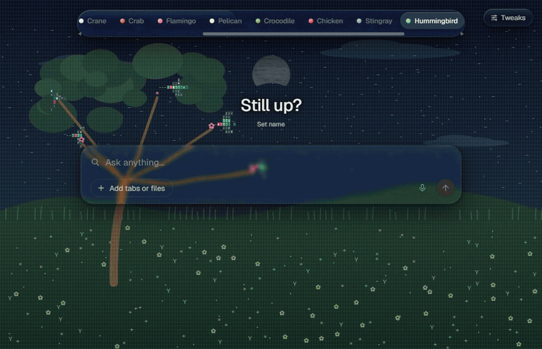

# ASCII Animals

Fifteen animated ASCII animals, each with a habitat, drawn on an interactive canvas. Run it as a website or use it as a Brave New Tab extension that shows the next animal every time you open a tab.

[](https://lethaldroid.github.io/ascii-animals/)

[**Open the live preview**](https://lethaldroid.github.io/ascii-animals/) · [Try the chameleon](https://lethaldroid.github.io/ascii-animals/?animal=chameleons) · [Install in Brave](#install-as-a-brave-new-tab-extension)

## Contents

- [Explore the scenes](#explore-the-scenes)
- [Meet the animals](#meet-the-animals)
- [Run the website locally](#run-the-website-locally)
- [Install as a Brave New Tab extension](#install-as-a-brave-new-tab-extension)
- [How the project works](#how-the-project-works)
- [Add an animal or habitat](#add-an-animal-or-habitat)
- [Build and publish](#build-and-publish)
- [Credits and license](#credits-and-license)

## Explore the scenes

- **Pick an animal.** The top bar follows the display order in the animal registry. Scroll horizontally to see every choice, or focus the selected animal and use the arrow keys.
- **Interact with the canvas.** Click near a creature to see its reaction. Koi treat clicks as food, while the chameleon starts its next color transition. Click near the firefly bush to make nearby fireflies flare.
- **Personalize the greeting.** Select **Set name** below the greeting. The app uses the time on your device and saves the name in this browser. To remove it, use **Edit name**, clear the field, and save.
- **Adjust a scene.** Open **Tweaks** to change movement, density, visual detail, or species-specific settings. Double-click a control’s label to reset it. **Copy** exports the changes as JSON. Settings are saved separately for each animal.
- **Reduced motion.** The canvas shows a still frame when the browser reports a reduced-motion preference.

The glass composer is a UI concept inspired by Dia. Submitting text emits a `chat:submit` event with the text. It has no chat backend, file picker, or voice integration.

## Meet the animals

| Animal | Habitat | Movement and interaction |
| --- | --- | --- |
| [Butterfly](https://lethaldroid.github.io/ascii-animals/?animal=butterflies) | Garden | Blue morphos flutter, zigzag, and glide. |
| [Koi](https://lethaldroid.github.io/ascii-animals/?animal=koi) | Koi pond | Fish swim along S-curves. Click the water to drop food for nearby koi. |
| [Jellyfish](https://lethaldroid.github.io/ascii-animals/?animal=jellyfish) | Deep sea | Magenta bells pulse and light up, with frilled tentacles and drifting particles. |
| [Dragonfly](https://lethaldroid.github.io/ascii-animals/?animal=dragonflies) | Dark marsh | Emerald hawkers hover, dart, and cruise across the full canvas on translucent wings. |
| [Frog](https://lethaldroid.github.io/ascii-animals/?animal=frogs) | Marsh | Spotted frogs pause, then leap and splash on landing. |
| [Crane](https://lethaldroid.github.io/ascii-animals/?animal=cranes) | Open sky | Red-crowned cranes alternate flapping and gliding. The optional folding flap adds a quick, jointed upstroke. |
| [Crab](https://lethaldroid.github.io/ascii-animals/?animal=crabs) | Sandy shore | Crabs scuttle sideways, stop, and leave footprints. They bolt with raised claws when startled. |
| [Flamingo](https://lethaldroid.github.io/ascii-animals/?animal=flamingos) | Shallow pond | Pink flamingos wade, rest on one leg, and make ripples around their feet. |
| [Pelican](https://lethaldroid.github.io/ascii-animals/?animal=pelicans) | Coastal sky | Broad wingbeats alternate with low glides. Look for the pouch bill and dark wingtips. |
| [Crocodile](https://lethaldroid.github.io/ascii-animals/?animal=crocodiles) | Muddy, reed-lined water | Crocodiles sweep their tails and slip under the surface when startled. |
| [Chicken](https://lethaldroid.github.io/ascii-animals/?animal=chickens) | Dirt farmyard | Chickens bob, stop to peck, and flap when they scurry away. |
| [Stingray](https://lethaldroid.github.io/ascii-animals/?animal=stingrays) | Seabed | Stingrays glide on rippling fins and bank away from a nearby click. |
| [Hummingbird](https://lethaldroid.github.io/ascii-animals/?animal=hummingbirds) | Flowering tree | Hummingbirds hover near blossoms, dart between branches, and perch on branch tips. |
| [Chameleon](https://lethaldroid.github.io/ascii-animals/?animal=chameleons) | Low woodland branch | A chameleon grips the branch, swivels its eye, and shifts between green, teal, violet, and amber in a head-to-tail wave. |
| [Firefly](https://lethaldroid.github.io/ascii-animals/?animal=fireflies) | Nighttime bush | Fireflies drift within leafy clusters and flash with bright gold centers and amber halos. |

## Run the website locally

Install Node.js and npm. Node.js 22 or later is a straightforward choice for this checkout.

```bash
git clone https://github.com/Lethaldroid/ascii-animals.git
cd ascii-animals
npm ci
npm run dev
```

Open the local URL Vite prints, usually `http://localhost:5173/`. The app is written in TypeScript and uses Canvas 2D, the DOM, and browser storage. It has no runtime npm dependencies.

The website remembers the last animal you selected. To open a specific scene, add `?animal=koi` or another key from the [registry](src/animals/index.ts). You can also pin the population with a positive integer, for example `?animal=koi&count=12`. Omit `count` to use the automatic population. Animals designed for a single subject, such as the chameleon, look best at their default count.

```bash
npm run typecheck      # check TypeScript
npm run build          # static website output in dist/
npm run build:extension  # unpacked extension output in dist-extension/
```

## Install as a Brave New Tab extension

The extension uses a [Manifest V3 New Tab override](https://developer.chrome.com/docs/extensions/develop/ui/override-chrome-pages). It supplies the animated page inside each new tab. A browser theme controls static browser appearance.

1. Clone the fork and run `npm ci` if you have not done so already.
2. Run `npm run build:extension`.
3. In desktop Brave, open `brave://extensions`.
4. Turn on **Developer mode**, then choose **Load unpacked**.
5. Select the entire `dist-extension` folder. It contains the generated `manifest.json`.
6. Open a new tab. Open a few more to see the scenes advance.

### Rotation and storage

| Action | What happens |
| --- | --- |
| Open a new tab | The extension picks the next of the 15 animals in registry order. After Firefly, it starts again at Butterfly. |
| Open several tabs quickly | The extension serializes updates so each tab advances the shared rotation once. |
| Reload a tab | It keeps the animal already shown in that tab. |
| Choose a different animal from the picker | That tab changes. The shared rotation keeps its place. |
| Set a name or adjust a scene | The extension saves the change in its own browser storage. The hosted website uses separate storage. |

The extension bundles its scripts, stylesheet, and image locally. It works offline, uses system fonts, requests no extension permissions, and needs no Vite process. The rotation uses local storage for the sequence, per-tab session storage for the displayed scene, and a Web Lock to coordinate tabs.

### Update, troubleshoot, or remove

- **Update your build.** Pull the changes, rerun `npm ci` if the lockfile changed, and run `npm run build:extension` again. On `brave://extensions`, click the extension’s **Reload** button.
- **Brave says the manifest is missing.** Select `dist-extension` itself. The repository root and `dist` are for the source and website respectively.
- **A different page opens.** Confirm **ASCII Animals New Tab** is enabled and check whether another extension supplies your New Tab page. Try a regular window if you are in a private window.
- **Restore Brave’s New Tab page.** Disable or remove **ASCII Animals New Tab** in `brave://extensions`.

## How the project works

| File | Responsibility |
| --- | --- |
| [`demo.ts`](demo.ts), [`ui.ts`](ui.ts), [`panel.ts`](panel.ts) | Start the canvas, wire up the picker and composer, and persist the greeting and tuning. |
| [`src/engine.ts`](src/engine.ts) | Own the animation loop, fixed simulation steps, resizing, pointer input, scene changes, and reduced-motion handling. |
| [`src/flock.ts`](src/flock.ts) | Manage population, depth, motion, world events, and common steering. Habitat bands keep some species within the appropriate part of the frame. |
| [`src/renderer.ts`](src/renderer.ts) | Rasterize silhouettes to a character grid, draw line glyphs and dots, and group trail marks by opacity for efficient rendering. |
| [`src/animals/`](src/animals/) | Define the animals, sample their silhouettes and colors, and handle their individual movements. |
| [`src/animals/habitats.ts`](src/animals/habitats.ts) | Paint sky, water, and terrain once when the background is rebuilt. Some species add custom features tied to their motion, such as the hummingbirds’ tree. |
| [`new-tab.ts`](new-tab.ts) | Select and remember the animal for a browser tab. |
| [`extension/build.mjs`](extension/build.mjs) | Build the offline extension and emit its manifest. |

Animals draw through the renderer’s `Pen` API. A silhouette sampler defines which points belong to an animal and the ink at each point. The renderer samples the shape on a grid, chooses a glyph for each covered cell, and draws the result. That keeps the animal’s shape and behavior independent from Canvas drawing details.

To reuse the engine with your own canvas:

```ts
import { AnimalEngine } from "./src";

const engine = new AnimalEngine(canvas, {
  animal: "jellyfish",
  theme: "dark",
  tuning: { speed: 1.4 },
});

engine.setAnimal("cranes");
engine.set("density", 2);

// Call engine.destroy() when removing the canvas.
```

## Add an animal or habitat

1. Add a species module under [`src/animals/`](src/animals/). Start with a comparable animal and implement its creature state, update, and draw methods. Add a startle handler if it needs a distinct click reaction.
2. Select a backdrop in [`habitats.ts`](src/animals/habitats.ts), or implement `paintBackdrop` in the animal module for features that must line up with its motion.
3. Add the species to [`src/animals/index.ts`](src/animals/index.ts). Registry order drives both the picker and the extension rotation.
4. Open the scene directly with `?animal=your-key`. Try a narrow window, a click on the canvas, a scene switch, and reduced motion. Then run the typecheck and both builds.

## Build and publish

The website is a static build. Run `npm run build` and serve `dist/` at the root of a static host. For a GitHub Pages project site served below a repository path, build with that path as the base:

```bash
npm run build -- --base=/ascii-animals/
```

Publish the contents of `dist/` to the root of the Pages branch, with an empty `.nojekyll` file. Keep the animation GIF in [`docs/preview.gif`](docs/preview.gif) on the source branch. The README preview was recorded from the running app.

## Credits and license

This is a fork of [DesignerStephen1/ascii-animals](https://github.com/DesignerStephen1/ascii-animals). The original demo is available at [Pocket Studio](https://pocketstudio.design/ascii-animals-app/index.html), and the upstream engine and renderer build on [ascii-sharks](https://github.com/stackedlol/ascii-sharks). The Dia-inspired composer is a concept redesign and is unaffiliated with Dia.

The project is released under the [MIT License](LICENSE).
